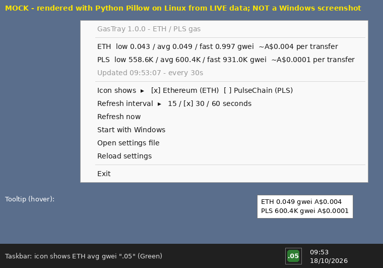

# eth-pls-gas-tray (GasTray)

A small **Windows 11 system-tray gas meter** for **Ethereum (ETH)** and **PulseChain (PLS)**, written in PowerShell + WinForms.
It needs no API keys, no admin rights, and nothing to compile.



> The preview images in `screenshots/` are **mocks** drawn with Python Pillow on Linux from live data. They are not Windows screenshots (see *Tested / Not tested* below).

## Features
- The tray icon shows the current **avg gas (gwei)** as text, e.g. `.05`, `23`, `671K` or `1.2M`, coloured **green / amber / red** by thresholds you set.
- The **tooltip** shows avg gwei and a rough AUD cost for both chains.
- The **right-click menu** shows:
  - ETH and PLS **low / avg / fast** gwei, plus the approximate **A$ cost of a 21,000-gas transfer**. Click a chain line to show that chain on the icon.
  - **Icon shows**: ETH or PLS
  - **Refresh interval**: 15 / 30 / 60 seconds (default 30)
  - **Refresh now** (double-clicking the icon does the same)
  - **Start with Windows** toggle (`HKCU\...\Run`, no admin needed)
  - **Open settings file** / **Reload settings**
  - **Exit**
- **The UI never blocks.** RPC calls run in a background runspace. Each endpoint has an 8 s timeout and falls back to the next one. A hung fetch is abandoned after 120 s.
- Only one instance runs at a time. A log file is kept at `%APPDATA%\GasTray\gastray.log`.

### How gas is calculated
`eth_feeHistory(20 blocks, "latest", [10, 50, 90])` gives the next-block base fee plus the median priority tip at the 10th, 50th and 90th percentiles, for **low**, **avg** and **fast**. If `eth_feeHistory` fails on every endpoint, the app falls back to `eth_gasPrice`, and all three tiers show that one value.
Transfer cost is `gwei × 21000 × 1e-9 × price`. If the price lookup fails, the fiat cost is simply hidden.

## Install (one-liner, per-user)
```powershell
irm https://raw.githubusercontent.com/mezzanine78/eth-pls-gas-tray/main/install.ps1 | iex
```
This downloads the app to `%LOCALAPPDATA%\GasTray`, adds a **Start Menu → GasTray** shortcut and starts the app. Windows may hide new tray icons under the `^` overflow, so drag it onto the taskbar if you want it always visible.

To pass options:
```powershell
# install and enable start-with-Windows
& ([scriptblock]::Create((irm https://raw.githubusercontent.com/mezzanine78/eth-pls-gas-tray/main/install.ps1))) -StartWithWindows
# install without launching
& ([scriptblock]::Create((irm https://raw.githubusercontent.com/mezzanine78/eth-pls-gas-tray/main/install.ps1))) -NoStart
```

## Manual run (from a clone or zip)
```powershell
# tray app with no console window
powershell.exe -NoProfile -ExecutionPolicy Bypass -STA -WindowStyle Hidden -File .\src\GasTray.ps1
# or double-click src\GasTray.vbs (hidden launcher)

# console self-test: fetch once, print, exit (also works with pwsh on Linux/macOS)
powershell.exe -NoProfile -ExecutionPolicy Bypass -File .\src\GasTray.ps1 -SelfTest

# install from a local clone (copies .\src instead of downloading)
powershell.exe -NoProfile -ExecutionPolicy Bypass -File .\install.ps1
```
Works with Windows PowerShell 5.1 (built into Windows 11) and PowerShell 7+.

## Settings
`%APPDATA%\GasTray\settings.json` is created on first run. Edit it through **Open settings file**, then choose **Reload settings**.
```json
{
  "IconChain": "ETH",
  "IntervalSec": 30,
  "Currency": "aud",
  "CurrencySymbol": "A$",
  "ShowFiat": true,
  "PriceRefreshSec": 300,
  "TimeoutSec": 8,
  "Thresholds": {
    "ETH": { "Amber": 5,       "Red": 20 },
    "PLS": { "Amber": 1000000, "Red": 3000000 }
  },
  "Rpc": {
    "ETH": ["https://ethereum-rpc.publicnode.com", "https://eth.drpc.org", "https://rpc.flashbots.net", "https://rpc.mevblocker.io"],
    "PLS": ["https://pulsechain-rpc.publicnode.com", "https://rpc.pulsechain.com", "https://rpc-pulsechain.g4mm4.io"]
  }
}
```
- Thresholds are compared against the **avg** tier, in gwei. The icon turns amber at `>= Amber` and red at `>= Red`.
- `Currency` can be any CoinGecko `vs_currency` (`usd`, `eur` and so on). Set `CurrencySymbol` to match.
- RPC lists are tried in order. Any keyless HTTPS JSON-RPC endpoint works.

## Uninstall
```powershell
powershell -ExecutionPolicy Bypass -File "$env:LOCALAPPDATA\GasTray\uninstall.ps1"            # removes everything
powershell -ExecutionPolicy Bypass -File "$env:LOCALAPPDATA\GasTray\uninstall.ps1" -KeepSettings
# or
& ([scriptblock]::Create((irm https://raw.githubusercontent.com/mezzanine78/eth-pls-gas-tray/main/install.ps1))) -Uninstall
```
Uninstalling removes the running instance, the Run entry, the Start Menu shortcut, `%LOCALAPPDATA%\GasTray` and, unless you pass `-KeepSettings`, `%APPDATA%\GasTray`.

## Data sources (all free and keyless)
| Chain | Endpoints (in fallback order) |
|---|---|
| ETH | ethereum-rpc.publicnode.com, eth.drpc.org, rpc.flashbots.net, rpc.mevblocker.io |
| PLS | pulsechain-rpc.publicnode.com, rpc.pulsechain.com, rpc-pulsechain.g4mm4.io |
| Price | api.coingecko.com `/api/v3/simple/price?ids=ethereum,pulsechain&vs_currencies=aud`, fetched every 5 min to stay inside the free rate limit |

These endpoints were dropped after testing on 2026-10-18. `eth.llamarpc.com` returned HTTP 525. `cloudflare-eth.com` returned an "Internal error" for `eth_feeHistory` and `eth_gasPrice`. `1rpc.io/eth` and `eth.merkle.io` were rate-limited.

## Project layout
```
install.ps1                 one-liner installer / uninstaller
src/GasTray.ps1             tray app (WinForms UI, background fetch, -SelfTest)
src/GasTray.Core.psm1       RPC + parsing + formatting + settings (no UI; testable anywhere)
src/GasTray.vbs             hidden launcher (no console flash)
src/uninstall.ps1           copied into the install folder
tests/GasTray.Core.Tests.ps1  Pester 5+ tests (tag "Live" hits the real endpoints)
tools/Test-Syntax.ps1       parser + PSScriptAnalyzer check
tools/render_mock.py        Pillow mock previews
```
Run tests: `Invoke-Pester ./tests` (add `-ExcludeTag Live` to stay offline).

## Tested / Not tested
**Tested (Linux box, Debian 13, pwsh 7.4.6, 2026-10-18):**
- Pester: **35/35 passed**. That covers hex parsing, fee-history maths, formatting, thresholds, settings merge and JSON round-trip, a mocked `eth_gasPrice` fallback, and "all endpoints dead" returning no data without throwing.
- **Live** tests against every default endpoint. Each one answered `eth_feeHistory`, and the fallback past a dead first URL worked for both chains. CoinGecko returned AUD prices, and a dead price URL hid the fiat cost. Real values seen: ETH avg ~0.05–0.06 gwei, PLS avg ~540K–620K gwei, ETH A$3,446, PLS A$0.00001063. See `tests/live-results.txt`.
- `GasTray.ps1 -SelfTest` end to end.
- Parser: 0 syntax errors in every `.ps1`/`.psm1`. PSScriptAnalyzer `PSUseCompatibleSyntax` reported 0 findings for 5.1 and 7.0. The remaining analyzer notes are intentional empty `catch {}` blocks and missing help comments.

**Not tested:**
- **The WinForms tray UI, icon drawing (System.Drawing), menu, Run-key toggle, installer, shortcut and uninstaller have not been run on real Windows yet.** WinForms and System.Drawing do not run on Linux. The preview PNGs are Pillow mocks of the same layout.
- Windows PowerShell 5.1 itself. Compatibility was checked statically only.
- Readability of 4-character values (e.g. `671K`) at 16 px / 100 % scaling. They will be small. Use 125 %+ scaling, or let the icon show ETH.
